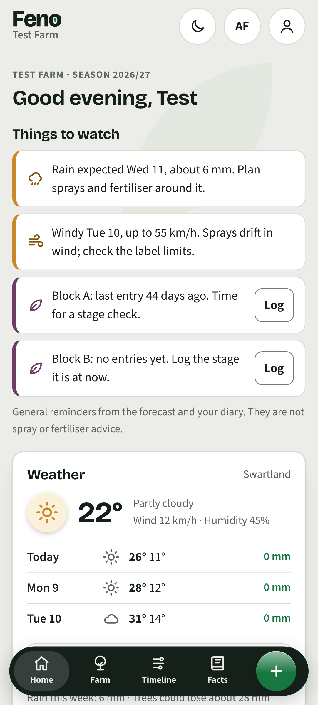
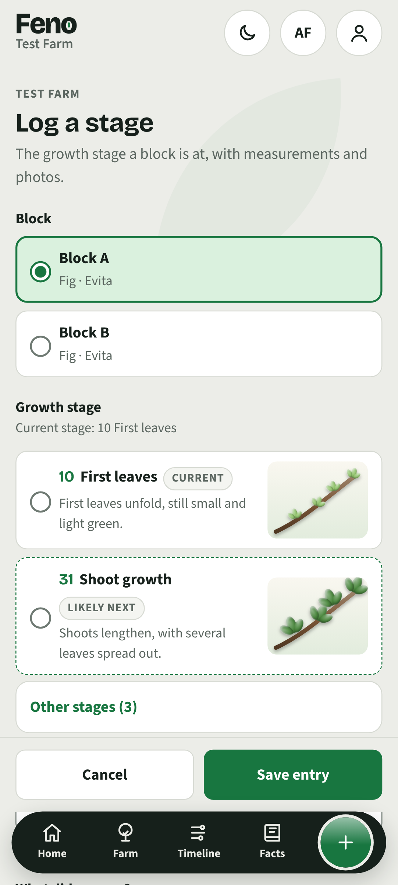
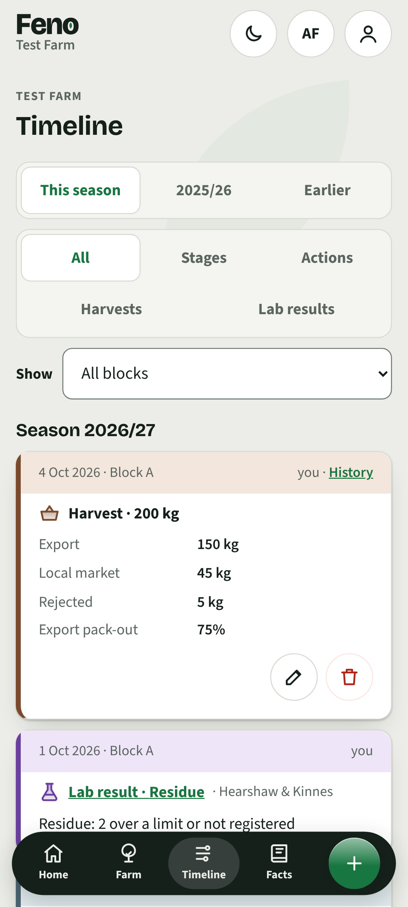
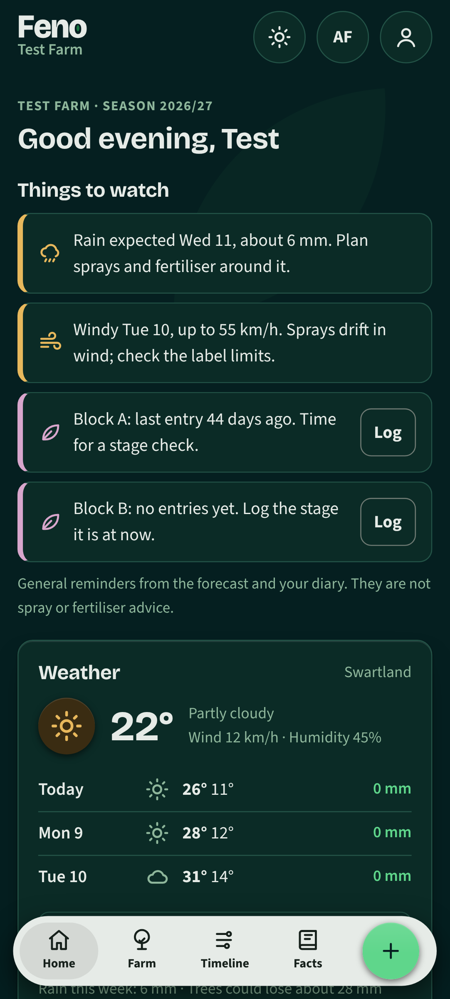
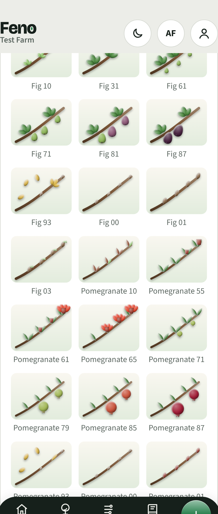
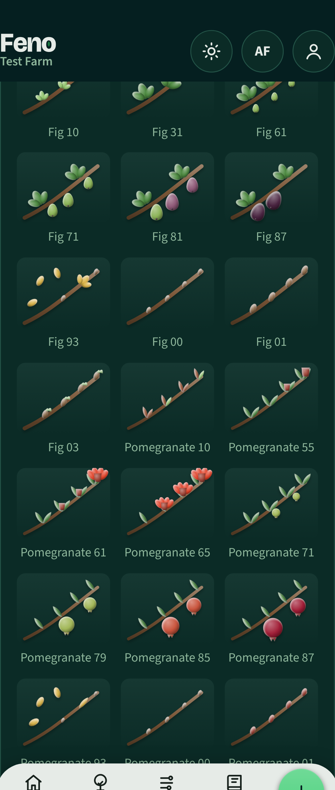
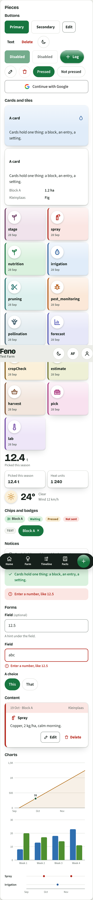
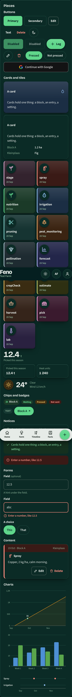

# Feno Design

The design system behind [Feno](https://github.com/Inzicht-Analytics/feno-showcase), a season diary for fig and pomegranate growers in the Western Cape, in English and Afrikaans. This repository holds the brand book, the design tokens, the logo files, the design spec and screenshots of the result. The app's code is private because it runs a live pilot with real farms; everything about how it looks is here.

**Product owner and designer:** Belinda Kennedy · [Portfolio](https://inzicht-analytics.github.io/) · [LinkedIn](https://www.linkedin.com/in/belinda-kennedy-analyst/)

The direction, in one line: **a field notebook with Headspace polish.** Warmth and craft from paper, soil and leaf tones and illustration; finish from type hierarchy, spacing, soft depth and motion. The only fixed thing was the name.

  
  
  
  

Screenshots use made-up test data.

## What is here

| Folder | What it holds |
| --- | --- |
| [`brand/`](brand/) | The brand book: [identity](brand/identity.md), [voice](brand/voice.md) in both languages, [logo](brand/logo.md), [colour](brand/colour.md), [type](brand/type.md), [spacing](brand/spacing.md), [motion](brand/motion.md), [illustration](brand/illustration.md), [photography](brand/photography.md), [print](brand/print.md), [messaging](brand/messaging.md), and the dated [decisions log](brand/decisions.md) |
| [`brand/logo/`](brand/logo/) | The mark, wordmark and lockup as SVG masters |
| [`tokens/`](tokens/) | [`tokens.json`](tokens/tokens.json), the one source of every value in the W3C design-tokens format; [`tokens.css`](tokens/tokens.css), what the app reads; [`figma-variables.json`](tokens/figma-variables.json), what the Figma file loads |
| [`spec/`](spec/) | The [design spec](spec/2026-11-07-feno-brand-library-design.md) of 7 November 2026 that the library was built from |
| [`screens/`](screens/) | The brand library screen inside the app (colours, type, spacing, icons, growth stages, pieces, motion, logo) and the main screens, in both themes |

## How it works

Code is the master and Figma is the mirror. `tokens.json` has three layers: primitives (colour, font, space, radius, duration, easing), semantic values per theme (light and dark, the names the stylesheet uses) and component values only where a piece needs its own. A generator writes `tokens.css` and `figma-variables.json` from it; the app's stylesheet holds no raw values, and the build refuses a stale file.

Three tests guard the system on every change:

- **Contrast.** Every text or icon pair the app relies on is listed with its floor (4.5:1 for text, 3:1 for icons and edges, WCAG 2.1 AA). The build fails when a pair drops below its floor in either theme.
- **No orphans.** A token defined and unused, or used and undefined, fails the build.
- **Accessibility.** A `/brand` screen inside the app shows every piece in every state, both themes, both languages, so axe checks all of it in CI.

## The pieces

  
  

  
  

  
  

The 21 growth-stage drawings follow the BBCH scale for figs and pomegranates. Each is drawn in code as clay-like shapes lit from the top left, with one SVG filter and a radial gradient per plant colour, on a plate that reads the theme's tokens, so the same drawing works in light and dark. Icons are line icons with a lit fill under the line in the icon's own colour.

## What was decided, and why

The [decisions log](brand/decisions.md) keeps one dated line per choice. The ones that shaped the most:

- The library covers the whole brand, not only the app: PDFs, decks, messages and a future website should look like one thing.
- Everything about the look was open except the name. Four personalities were written up; the field notebook with consumer-grade finish won.
- Three visual directions were mocked up on real screens; one was chosen and the tokens cut from it.
- Kind colours (each kind of diary entry has its own) sit on icons and edges, never on text, so they are held to 3:1 rather than 4.5:1.
- Fonts moved to the app's own files, so no font request leaves the phone and the privacy policy could say so.
- Controls follow one rule per job: full-width buttons for what a grower does every day on a card, round icon buttons for edit and delete, a filled pill for Log.

## Figma

A Figma file mirrors the tokens as variables and the components pushed from code. It is a view of the same values, never a second source. Ask for access.

## Reading the brand book here

The brand book is copied from the app's repository, where it lives beside the code. Paths it names, such as `src/tokens.css`, `scripts/tokens.mjs` or `brand/references/001`, are in that private repository; the reference screenshots stay there because they are other people's work.

## Reuse

Shared to show the work. The Feno name, mark, wordmark and drawings are Feno's; the method, the token pipeline and the tests are free to learn from.
